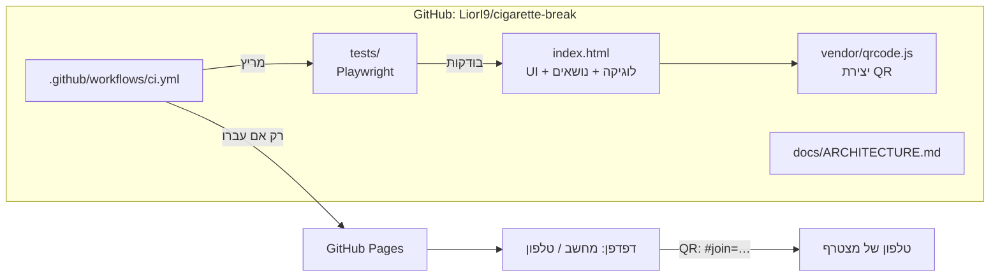
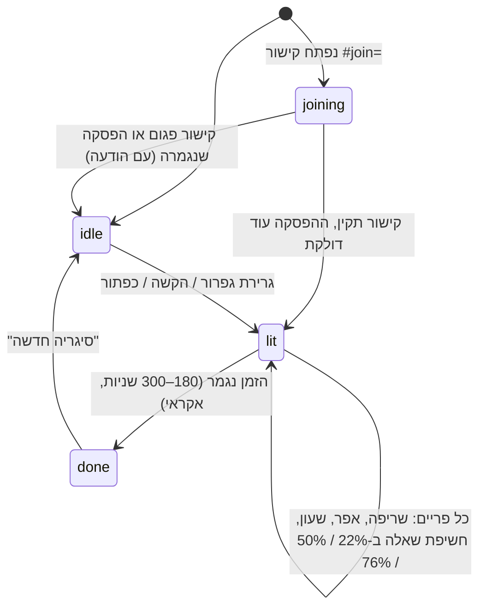
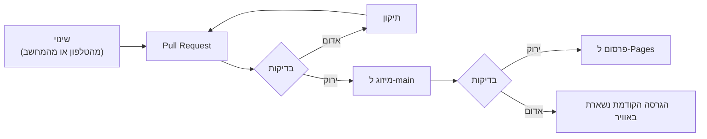
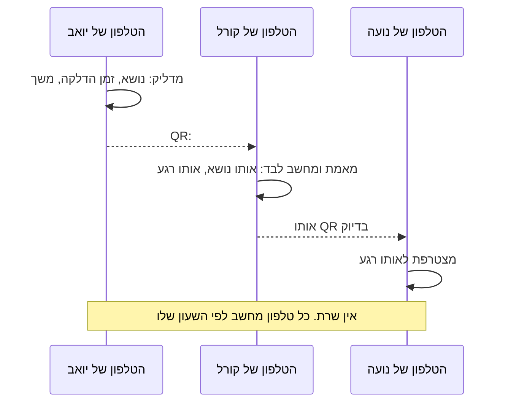

# הפסקת סיגריה: מסמך ארכיטקטורה

> מסמך חי. כל יכולת חדשה מעדכנת אותו באותו PR שמוסיף אותה: את תמונת המצב, את יומן היכולות, ואם התקבלה החלטה, גם רשומת החלטה.

| | |
|---|---|
| **ארכיטקט** | ליאור ישראל |
| **סטטוס** | הפסקה משותפת בקבוצה, בדרך למוצר לקהל רחב |
| **כתובת** | https://liori9.github.io/cigarette-break/ |
| **עודכן לאחרונה** | 2026-10-29 |

---

## 1. חזון

אפליקציה למי שלא מעשן, אבל לא מוותר על ההפסקה. מדליקים סיגריה וירטואלית, ובזמן שהיא נשרפת (3 עד 5 דקות) מקבלים נושא לשיחה ושאלות המשך שמחזיקים את השיחה בדיוק לאורך הפסקה אחת.

**לאן:** מוצר לקהל רחב שנשאר פשוט, ושאפשר להמשיך לפתח מהטלפון.

## 2. עקרונות

1. **קודם כל אנשים.** המוצר הוא השיחה, לא הסיגריה. כל פיצ'ר נמדד לפי השאלה אם הוא מוביל לשיחה טובה יותר.
2. **אתר סטטי כל עוד אפשר.** אין שרת ואין build. שכבה חדשה נכנסת רק כשיש צורך מוכח, ומתועדת כהחלטה.
3. **תוכן בנפרד מקוד** (יעד): נושאים צריכים להיות ניתנים לעריכה בלי לגעת בלוגיקה.
4. **שום דבר לא עולה לאוויר בלי בדיקות.** ה-CI הוא רשת הביטחון, ובמיוחד כשמפתחים מהטלפון ואין סקירת קוד על מסך גדול.
5. **עובדים בכיף, ממוקד ויעיל.** צעדים קטנים, כל אחד שלם: קוד, בדיקה ותיעוד.

## 3. תמונת מצב

### רכיבים

| רכיב | קובץ | אחריות |
|---|---|---|
| ממשק | `index.html` (HTML + CSS) | עיצוב רטרו, RTL, מותאם לטלפון. גופנים מ-Google Fonts עם גופני גיבוי |
| מכונת מצבים | `index.html` (script) | `idle → lit → done`, שעון, חשיפת שאלות המשך |
| סיגריה ועשן | `index.html` (DOM + Canvas) | נייר, אפר שנופל וגחלת ב-DOM. עשן בחלקיקים על Canvas |
| נושאים | `index.html`, קבוע `RAW` | 90 נושאים, לכל אחד 3 שאלות המשך, מופרדים ב-`\|` |
| זיכרון מקומי | `localStorage` | אילו נושאים כבר הוצגו, כדי שלא יחזרו עד שעוברים על כולם |
| שיתוף | `index.html` | העתקה ללוח (עם גיבוי בשדה טקסט) וקישור `wa.me` |
| הפסקה משותפת | `index.html` + `vendor/qrcode.js` | קוד QR עם קישור `#join=`. מי שסורק מחשב את אותו מצב בעצמו, בלי שרת |
| בדיקות | `tests/app.spec.js`, `tests/shared.spec.js` | 21 בדיקות × 2 מסכים (מחשב, Pixel 7), עם שעון מדומה. בבדיקות המשותפות שני דפדפנים נפרדים |
| שרת בדיקות | `tests/serve.js` | שרת סטטי מינימלי בלי תלויות, גם ל-`npm start` |
| שחרור | `.github/workflows/ci.yml` | בדיקות על כל PR. ב-push ל-`main` בדיקות ואז פרסום |

### מכונת המצבים

### זרימת שחרור

### הפסקה משותפת

**פורמט הקישור:** `#join=<גרסה>.<מספר נושא>.<זמן הדלקה ב-ms, בסיס 36>.<משך בשניות>.<בדיקת תקינות של שתי ספרות>`

- **בדיקת התקינות** היא hash קצר של טקסט הנושא. היא מזהה קישור ישן אחרי שרשימת הנושאים השתנתה.
- **הקישור נדחה** כשהמשך לא בין 180 ל-300 שניות, או כשזמן ההדלקה רחוק יותר מדקה בעתיד, למשל טלפון ששעונו מכוון לא נכון.
- **אחרי קריאה הקישור נמחק מהכתובת**, כדי שרענון הדף לא יחזיר להפסקה ישנה.

## 4. איך עובדים

- **כל שינוי נכנס ב-PR**, גם כשמבקשים אותו מהטלפון. הבדיקות רצות על ה-PR, ומיזוג מפעיל את השחרור.
- **כל PR שמוסיף יכולת מעדכן את המסמך הזה:** את תמונת המצב (סעיף 3), שורה ביומן היכולות (סעיף 6), ורשומת החלטה (סעיף 7) אם הייתה הכרעה.
- **בדיקות מקומיות:** `npm install`, `npx playwright install chromium`, `npm test`.
- **שאלות והחלטות** מוצגות עם 4 אפשרויות. אפשר לבחור אחת, כמה ביחד, או לכתוב תשובה אחרת.

## 5. איכות

| מה | איך זה נבדק |
|---|---|
| תקינות תוכן | לכל נושא 3 שאלות המשך, אין נושאים כפולים, ולפחות 90 נושאים |
| הדלקה | כפתור, הקשה וגרירת גפרור. גרירה קצרה מדי לא מדליקה |
| זמן ושריפה | משך בין 3 ל-5 דקות, הנייר מתקצר, השעון יורד, השאלות נחשפות לפי הסדר |
| מחזור חיים | סוף הסיגריה, ואז סיגריה חדשה עם נושא אחר |
| שיתוף | הקישור לוואטסאפ מכיל נושא ושאלות. ההעתקה ללוח עובדת |
| הפסקה משותפת | שני דפדפנים נפרדים: אותו נושא, אותו שעון, אותן שאלות חשופות, וסיום ביחד. מצטרף יכול להזמין הלאה. ה-QR מצויר. קישורים פגומים, ישנים ומהעתיד נדחים |
| פריסה | אין גלילה אופקית, אין שגיאות JavaScript, במחשב ובטלפון |

הבדיקות אומתו בכך ששברו את הקוד בכוונה וראו אותן נכשלות: משך הסיגריה, תזמון השאלה השלישית, והתעלמות מזמן ההדלקה שבקישור.

## 6. יומן יכולות

| תאריך | יכולת | מה השתנה בארכיטקטורה |
|---|---|---|
| 2026-10-25 | גרסה ראשונה | קובץ HTML אחד: ממשק, מכונת מצבים, 90 נושאים, עשן על Canvas |
| 2026-10-29 | repo ו-GitHub Pages | ה-repo נפתח, והאתר פורסם מהענף `main` |
| 2026-10-29 | בדיקות ושער שחרור | Playwright במחשב ובטלפון. GitHub Actions מפרסם רק אחרי שהבדיקות עוברות. מקור Pages הועבר ל-GitHub Actions |
| 2026-10-29 | מסמך ארכיטקטורה חי | המסמך הזה, `CLAUDE.md` עם כללי העבודה, ותבנית PR עם רשימת בדיקה |
| 2026-10-29 | הפסקה משותפת בקבוצה | הזמנה ב-QR, מצב `joining`, ספריית QR מקומית ב-`vendor/`, ומשך הסיגריה בשניות שלמות כדי שיעבור בקישור. ה-CI מפרסם גם את `vendor/`. החלטות 5 ו-6 |

## 7. החלטות

כל החלטה כתובה בקצרה: הקשר, ההחלטה, ומה המחיר שלה.

### החלטה 1: קובץ HTML אחד, בלי build ובלי שרת
- **הקשר:** אפליקציה קטנה שצריכה לעלות לאוויר מהר ולהיות פשוטה לשינוי.
- **החלטה:** הכול ב-`index.html`. אין framework, אין bundler ואין backend.
- **מחיר:** הקובץ יגדל עם כל פיצ'ר. נבחן פיצול כשהוא יעבור כ-1,500 שורות, או כשיהיה רכיב שצריך לבדוק בנפרד.

### החלטה 2: הבדיקות חוסמות את השחרור
- **הקשר:** מפתחים גם מהטלפון, בלי סקירת קוד מעמיקה.
- **החלטה:** הפרסום ל-Pages רץ רק כ-job שתלוי בבדיקות (`needs: test`). מקור Pages הוא GitHub Actions, לא הענף.
- **מחיר:** שינוי טקסט קטן מחכה 2 עד 3 דקות לבדיקות. שווה את זה.

### החלטה 3: הבדיקות קוראות את המצב הפנימי של הדף
- **הקשר:** צריך לבדוק סיגריה של 5 דקות בלי לחכות 5 דקות.
- **החלטה:** שעון מדומה של Playwright, וקריאה של `S` ו-`TOPICS` מהדף.
- **מחיר:** קשר הדוק בין הבדיקות למימוש. שינוי שמות פנימיים ישבור בדיקות גם כשההתנהגות לא השתנתה. (ראו חוב טכני)

### החלטה 4: מסמך ארכיטקטורה חי ב-repo
- **הקשר:** המוצר גדל, ורוצים שכל צעד יהיה מתועד, ממוקד ויעיל.
- **החלטה:** מסמך אחד ב-`docs/ARCHITECTURE.md`, שמתעדכן באותו PR כמו הקוד. `CLAUDE.md` ותבנית ה-PR דואגים שזה יקרה.
- **מחיר:** עוד כמה שורות בכל PR.

### החלטה 5: הפסקה משותפת בלי שרת, כל המצב בתוך ה-QR
- **הקשר:** כמה אנשים שנמצאים יחד רוצים לצאת לאותה הפסקה. הם עומדים זה ליד זה, אז הם לא צריכים ערוץ תקשורת. הם צריכים רק נקודת התחלה משותפת.
- **החלטה:** הקישור ב-QR נושא את כל מה שצריך: נושא, זמן הדלקה ומשך. כל טלפון מחשב את המצב לבד לפי השעון שלו. מי שמצטרף באמצע מגיע לאותו רגע, וכולם מסיימים יחד. כל משתתף יכול להזמין את הבא עם אותו קוד.
- **מחיר:** אין רשימת משתתפים, ואין פעולה משותפת בזמן אמת, כמו דילוג לנושא אחר שמגיע לכולם. סטיית שעונים בין טלפונים, בדרך כלל עד שנייה או שתיים, מורגשת בשעון בלבד. אם יהיה צורך אמיתי באחד מאלה, זה השלב שבו מוסיפים שרת.

### החלטה 6: ספריית QR בתוך ה-repo
- **הקשר:** צריך לייצר QR בדפדפן.
- **החלטה:** `qrcode-generator` 1.4.4 (רישיון MIT, של Kazuhiko Arase) נשמרת ב-`vendor/qrcode.js` ולא נטענת מ-CDN.
- **מחיר:** 56KB לא מכווצים בתוך ה-repo, ועדכוני גרסה ידניים. בתמורה אין תלות בשרת חיצוני, והיא תעבוד גם ב-PWA בלי אינטרנט.

## 8. חוב טכני ושאלות פתוחות

- **הנושאים בתוך הקוד.** כדי להוסיף נושא צריך לערוך את `index.html`. היעד הוא `topics.json` עם קטגוריות.
- **בדיקות שתלויות במימוש** (החלטה 3). אפשר לחשוף ממשק בדיקה קטן ויציב, או לבדוק רק דרך מה שרואים במסך.
- **אין התקנה למסך הבית ואין עבודה בלי אינטרנט.** עדיין לא PWA.
- **אין מדידה.** לא ידוע כמה משתמשים יש ואילו נושאים עובדים. כל מדידה תיבחן קודם מול פרטיות.
- **אין ניטור לאתר החי.** הבדיקות רצות לפני הפרסום, לא אחריו.
- **קישורי הצטרפות תלויים בסדר הנושאים.** הוספת נושא באמצע הרשימה תשבור קישורים פעילים. הבדיקה תתפוס את זה ותציע סיגריה חדשה, אבל מזהה יציב לכל נושא ב-`topics.json` יפתור את זה לגמרי.

## 9. מפת דרכים

| שלב | יכולת | למה |
|---|---|---|
| הבא | נושאים ב-`topics.json` עם קטגוריות, ובדיקת תקינות ב-CI | עריכת תוכן מהטלפון בלי לגעת בקוד |
| הבא | PWA: אייקון, התקנה ועבודה בלי אינטרנט | קהל רחב בטלפון |
| בהמשך | בחירת קטגוריה לפני ההדלקה | התאמה לסוג ההפסקה |
| בהמשך | שמות המשתתפים בהזמנה ("יואב מזמין אותך") | יותר חם. השם עובר בקישור, בלי שרת |
| כשיהיה צורך | פעולות משותפות בזמן אמת ורשימת משתתפים | זה השלב שבו נצטרך שרת (ראו החלטה 5) |
